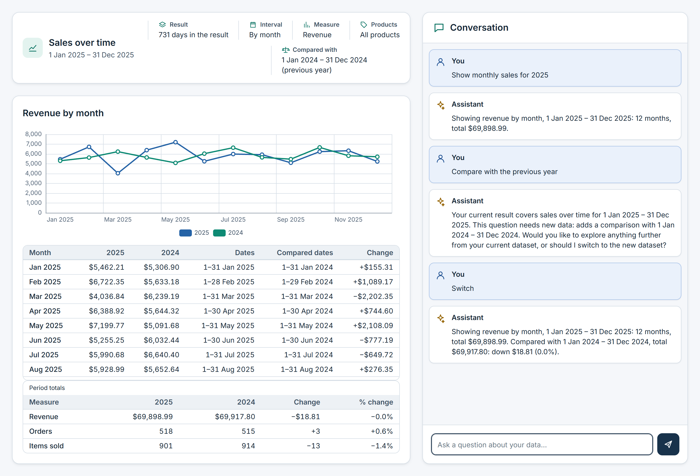
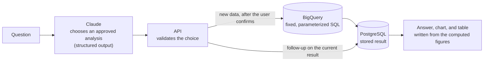

# Conversational Analytics Workbench


**Ask your data. See the evidence.**

Ask a business question in plain English and get an answer you can check. Claude chooses one approved analysis and fills in its settings; the API validates that choice; BigQuery and PostgreSQL calculate every number. The model never writes SQL and never sees the figures, so it cannot invent them. Each answer comes with a chart and the table of exact values behind it.



<sub>Demo mode with the synthetic development data. The real setup uses Google's public TheLook e-commerce dataset in BigQuery.</sub>

## What it does

- **Three analyses built**, of ten planned in the [capability catalogue](docs/product/AI-DATA-CAPABILITIES.md):
  - customer spending: top or lowest spenders, filters, and the share of spending from the top customers;
  - product sales, grouped by category, department, or brand;
  - sales over time by day, week, or month, optionally compared with the previous period, the previous year, or chosen dates.
- **Follow-up questions work on the current result.** Sorting, filtering, grouping, or changing the chart never reloads data. Loading a different period or dataset asks first (**Switch** or **Keep current**), so a result is never replaced silently.
- **Charts that suit the result:** line, bar, horizontal bar, pie, and table, each with its exact values.
- **Sign-in with server-side sessions.** One session per user; the analysis data is deleted when the session ends.

## How it stays accurate



- **The model only selects.** Its reply must match a strict schema; the API checks every field against the capability's rules and the stored result before anything runs.
- **Every query is fixed and parameterized.** No value from the model or the user is pasted into SQL.
- **The answer text is written by the application** from the computed figures, so every number in an answer comes from the backend's calculation, never from the model.

**Evidence:**

| Check                                                                        | Result                                                                       |
| ---------------------------------------------------------------------------- | ---------------------------------------------------------------------------- |
| Known-answer check: the BigQuery queries against reference calculation rules | 17 of 17 exact                                                               |
| Model evaluation: 61 decision cases on Claude Sonnet 5.5                     | 60 of 61 (98.4%), safety cases 11 of 11                                      |
| Cost and speed of a turn                                                     | about $0.003 and 2 s for the model decision                                  |
| Automated tests                                                              | about 1,050 (API and web), run in CI with lint, typecheck, format, and build |

## Tech stack

- **Web:** React, TypeScript, Vite, Tailwind CSS, ECharts
- **API:** NestJS, Prisma, PostgreSQL
- **Data and AI:** BigQuery (TheLook public dataset), Claude API with structured outputs
- **Quality:** Vitest, axe accessibility checks, live known-answer and model-evaluation suites
- **Delivery:** Docker Compose, GitHub Actions

## Try it (no accounts or keys needed)

The development defaults use a demo model that understands a fixed list of example questions (shown as buttons) and a synthetic dataset, so the app runs without any credentials or cost.

You need Node 24 (see `.nvmrc`) and Docker Desktop.

```bash
cp example.env .env                                   # local placeholders only
docker compose up --build -d
docker compose exec api node dist/seed/seed-cli.js   # creates the local account
```

Open **http://127.0.0.1:8080** (use exactly this address: `localhost` is a different origin and sign-in is refused) and sign in as `user@example.test` with the local development password from `docs/PROJECT-SETUP.md`. Try **Show monthly sales for 2025**, then **Compare with the previous year**.

## How it was built

Each feature went through a written spec with measurable acceptance criteria, test-first implementation, an independent review, and a recorded closeout, using AI coding agents within that workflow ([workflow](docs/AGENTIC-WORKFLOW.md)). The task records, including every decision and its reasoning, are in [docs/work/completed/](docs/work/completed/).

| Task     | Delivered                                                                                                                                                                            |
| -------- | ------------------------------------------------------------------------------------------------------------------------------------------------------------------------------------ |
| TASK-001 | Sign-in and sign-out, server-side sessions, NestJS API, PostgreSQL, Docker Compose                                                                                                   |
| TASK-002 | Design system: tokens, components, chart theme                                                                                                                                       |
| TASK-003 | The analysis workspace and the backend rules for each question, with a demo model ([architecture proposal](docs/ideas/2026-11-08-conversational-analytics/ARCHITECTURE-PROPOSAL.md)) |
| TASK-004 | Real adapters: BigQuery (TheLook) and Claude Sonnet 5.5, the known-answer check, and the model evaluation                                                                            |
| TASK-005 | Sales over time with comparisons, grouped product sales, and line, horizontal bar, and pie charts                                                                                    |

**Next:** more analyses from the catalogue, and a public showcase on AWS. Decisions and open items are in `docs/PROJECT-SETUP.md`.

## Run locally (development)

You need Node 24 (see `.nvmrc`) and Docker Desktop.

1. Copy the settings template: `cp example.env .env`. All values are local placeholders.
2. Install dependencies: `npm ci`.

The whole stack in Docker is described under [Try it](#try-it-no-accounts-or-keys-needed). For day-to-day development with instant reload:

```bash
docker compose up -d postgres         # database only
npm run db:deploy -w api              # apply migrations
npm run db:seed -w api                # local account
npm run dev -w api                    # API on http://localhost:3000
npm run dev                           # web on http://localhost:5173 (proxies /api)
```

The design reference page is at http://localhost:5173/design-reference (development only).

## The analysis workspace

After signing in, the workspace shows:

- the conversation;
- the active result as a chart with its table, or as a table;
- a summary of its scope;
- analysis figures with the rows they are based on.

The views depend on the result: bar, horizontal bar, or table for customers and products; also a pie when product sales are grouped; line, bar, or table for sales over time. The rules are in the [design system](docs/design/DESIGN-SYSTEM.md#chart-rules-per-result-shape-task-005).

- **How a question is handled:** a model reads the question and proposes one structured decision (refine, analyse, change the view, load data, confirm a switch, ask a question, or reply). The API checks that decision against the stored result and decides what actually happens. Every figure comes from the API, computed from the stored rows; the model never sees the rows or the figures.
- **Switching data:** loading a different capability or period, or for sales over time a different product filter or comparison, replaces the current result, so the workspace asks first (**Switch** or **Keep current**). Changing the interval, measure, grouping, or chart never loads data.
- **One turn at a time:** while a question is being answered, a second message gets a "still answering" reply, and a refreshed page shows a notice until the answer arrives. Signing out never waits for a slow answer.

**Model and data.** Two settings in `.env` choose them:

|                  | Development default (no credentials, no cost)                                                       | Real                                                   |
| ---------------- | --------------------------------------------------------------------------------------------------- | ------------------------------------------------------ |
| `ANALYSIS_MODEL` | `demo`: recognises a fixed list of example questions (shown as buttons under a "Demo mode" banner)  | `claude`: Claude Sonnet 5.5 via the Anthropic API      |
| `DATA_SOURCE`    | `fixture`: a deterministic synthetic set shaped like TheLook (about 400 customers and 120 products) | `bigquery`: Google's public, synthetic TheLook dataset |

Production refuses `demo` and `fixture`. Docker Compose uses the development defaults; run the real adapters with the npm dev servers.

**Using the real adapters** (each needs your own account; the keys stay outside this repository):

- **BigQuery:** create a Google Cloud project with the BigQuery API enabled (the free Sandbox is enough), run `gcloud auth application-default login` (the credentials file stays in your user profile), and set `DATA_SOURCE=bigquery` and `GOOGLE_CLOUD_PROJECT=<project id>` in `.env`. Each question that loads data scans about 10 MB (customers and products) or 8 MB (sales over time, including a comparison period), well inside the Sandbox's free monthly allowance; every query is capped at 1 GB.
- **Claude:** create an API key in the Anthropic Console, set a spend limit there (or keep prepaid credit with auto-reload off), and set `ANALYSIS_MODEL=claude` and `ANTHROPIC_API_KEY=<key>` in `.env`. A turn costs about $0.003 and takes about 2 s (measured by the evaluation, see below).

**Live checks** (never part of `npm test` or CI; each skips without its credentials):

- `npm run live:profile -w api`: profiles TheLook (free). Results: [docs/product/THELOOK-PROFILE.md](docs/product/THELOOK-PROFILE.md).
- `npm run live:test -w api`: known-answer check, about 25 queries (free in the Sandbox). The BigQuery queries must match the reference calculation rules exactly: customers, products with department and brand, and daily sales (unfiltered, for one category, and with a comparison period).
- `npm run live:eval -w api`: 61 model decision cases, about $0.19 per run. Passes at 90% overall and 100% of the safety cases. `EVAL_SAVE_BASELINE=1` stores the result in `api/src/live/eval/`, the baseline for comparing models later (`ANTHROPIC_MODEL` selects another model). `EVAL_CASES=id1,id2` reruns only some cases.
- Add `-- --silent=false` to see the output (hand-check material, measurements, and failures).

**Known limitations:**

- Sales over time can be filtered by category or department, not by brand or a single product.
- A brand filter on product results needs the exact brand name, because brand names are not sent to the model.
- “Top 10 brands by revenue” may be refused: the model sends a time-series measure for any number of brands, so grouping by brand always shows the top 20 ([TASK-005 DEC-003](docs/work/completed/TASK-005-sales-trends-and-groups/DECISION-LOG.md)).
- Brands that differ only in letter case are kept separate, as in the source data.

**Checks:** `npm run format:check`, `npm run lint`, `npm run typecheck`, `npm test` (API tests need the database running), and `npm run build`.

The local account and its weak password exist for local development and tests only. The seed refuses to run outside them, and the API refuses to start in production if that account exists.

## Agreed product boundaries

- One-page analytics app; all signed-in users have the same ordinary-user access. There is no admin role, admin page, or admin-only capability.
- Sign-in is included in the first local end-to-end slice and is required before the public AWS showcase.
- Each user has one session on one device; signing in elsewhere ends the previous one. The active analysis session and result set are user-scoped and stored server-side in PostgreSQL. They survive page refresh, and are deleted when the session ends (logout, closing the app without signing out, inactivity expiry, or a new sign-in). Logging in again starts fresh; saving and restoring prior analysis sessions is future scope.
- The AI may select and parameterize only an approved capability. It never generates executable SQL or invents metrics.
- Use the public TheLook e-commerce sample dataset only. Do not use employer materials, real customer data, production data, or real credentials.

## Project references

- `docs/product/AI-DATA-CAPABILITIES.md` — the capability catalogue (three built, seven planned) and interaction contract.
- `docs/security/SECURITY-BASELINE.md` — privacy and security requirements.
- `docs/design/DESIGN-SYSTEM.md` — visual direction and brand references.
- `assets/brand/` — selected logo assets and reference image.
- `docs/AGENTIC-WORKFLOW.md` — idea-to-delivery process and branch-before-spec gate.
